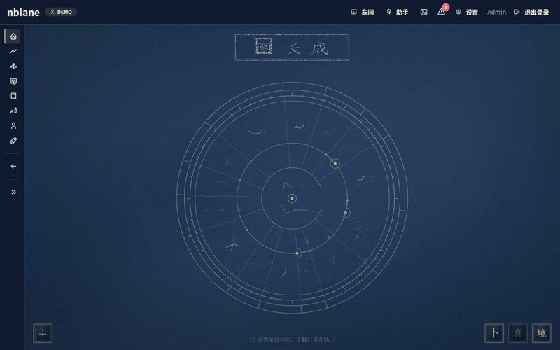

# nblane · 大佬之路

> **Human + Agent co-evolution.** You and your own agent form one long-term
> growth unit; Goal + Skill + Evidence form one reviewable capability map.

[中文](README.md) · The Chinese docs under [`docs/zh/`](docs/zh/README.md) are the source of truth.

nblane is a local-first growth workspace for AI-native researchers and developers. Reading, writing, projects, code and study notes become reviewable evidence, mapped onto goals, a skill tree, research material, public work and agent context.

Each person keeps a `SKILL.md`: a growth record that doubles as an agent system prompt. Everything is plain YAML / Markdown under `profiles/<name>/`, backed up with Git. No database.



## How it works

The core loop: **do the work → crystallize evidence → confirm it → light up skills → your agent knows you better**.

1. **Projects → evidence → skill tree.** Finished tasks become evidence; AI pre-fills strength and confidence, you confirm. Confirmed evidence advances skills on the tree.

   

2. **Read papers.** Library, reading queue, PDF reader with side-by-side translation, AI deep reading and an in-paper glossary.

   

3. **Write and publish.** BlockNote editor with AI cleanup and translation; the public site page previews exactly what goes live and publishes only after you confirm.

   

4. **Hand it to your agent.** `nblane context` prints `SKILL.md` as a system prompt. The assistant reads and writes over HTTP; writes are undoable and important ones need confirmation in chat.

GIFs are recorded with a fictional demo profile.

## Quick start

Requires Python ≥ 3.11, Git and tmux. Optional: Chromium (resume PDF, share cards), Node.js (only to rebuild the frontend).

```bash
git clone <repo-url> && cd nblane
scripts/install.sh              # venv + deps + environment check, then the setup wizard
```

Or step by step:

```bash
python3 -m venv .venv && .venv/bin/pip install -e .
.venv/bin/nblane setup          # interactive; see --help for non-interactive flags
.venv/bin/nblane doctor         # environment check with fix hints
scripts/dev-web.sh              # open http://127.0.0.1:8504
```

AI is optional; without a key the CLI and rule-based features still work.

The web UI (SPA + API on 8504, Reader API on 8502) covers the star map and goals, projects, skill tree, evidence, research (paper library and reader), content and career workspaces, and the public site build. On a server, turn on login and keep both ports on `127.0.0.1` behind a reverse proxy; see the [deployment guide](docs/zh/guides/deployment-tencent-cloud.md).

Contributors and coding agents: see [AGENTS.md](AGENTS.md).
