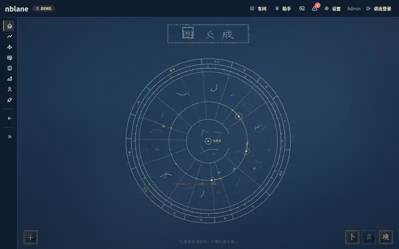

# nblane · 大佬之路

> **Human + Agent 共进化。** 你和自己的 Agent 是一个长期成长单元；
> 目标 + 技能 + 证据组成一张可审查的能力图谱。

[English](README.en.md)

nblane 是给 AI-native 研究者和开发者用的本地优先成长工作台。它把阅读、写作、项目、代码和学习记录沉淀成可审查的证据（evidence），映射到目标、技能树、研究资料、公开作品和 Agent 上下文里。

每个人有一份 `SKILL.md`：既是成长档案，也是 Agent 的系统提示词。把它交给任何 Agent，Agent 就按你的目标、技能和证据做事；文件更新，Agent 跟着更新。

所有数据都是 `profiles/<name>/` 下的 YAML / Markdown 文件，用 Git 备份，没有数据库。



## 怎么用

nblane 的核心是一个闭环：**做事 → 结晶证据 → 人确认 → 点亮技能 → Agent 更懂你**。

### 1. 做项目，结晶证据，点亮技能

在「项目」里按目标管理看板和时间轴。任务完成后结晶为证据，AI 预填分量和置信度，你只需确认。确认后的证据挂到技能树上，技能随之从「在学」进阶到「扎实」「精通」。


### 2. 读论文

「研究台」管理阅读节奏：论文库、继续阅读、阅读位置自动保存。阅读器支持原文 / 对照 / 仅译文、全文翻译、AI 研读和本文术语表；配了 GROBID 时按结构抽取正文。


### 3. 写作并发布

「内容工作台」用 BlockNote 写文章，AI 帮你整理长文、翻译、生成配图。「公开站点」左边勾选要展示的自我介绍、文章和作品，右边实时预览，确认后才发布。


### 4. 交给 Agent

`SKILL.md` 随数据自动更新，`nblane context` 把它打印成系统提示词，交给任意 Agent。助手（OpenClaw）通过 HTTP 读写你的档案：日常写入直接生效、可撤销，重要操作先在聊天里确认。

> 动图使用虚构的演示档案录制，重录方法见 [scripts/readme-gifs](scripts/readme-gifs/README.md)。

## 功能一览

| 区域 | 做什么 | 文档 |
|------|--------|------|
| 首页 | 星图（目标是恒星、技能是星座）、目标、习惯打卡 | [首页](docs/zh/guides/home.md) |
| 项目 | 看板、时间轴、里程碑，任务完成后结晶为证据 | [项目](docs/zh/guides/projects.md) |
| 技能树 | 领域技能图、证据支撑的点亮与进阶 | [技能树](docs/zh/guides/skill-tree.md) |
| 证据 | 证据池、AI 预填 + 人确认的审阅流程 | [证据](docs/zh/guides/evidence.md) |
| 研究 | 论文库、PDF 阅读器、翻译、深读、GROBID 结构化抽取 | [研究台](docs/zh/guides/research.md) |
| 内容 | BlockNote 写作、AI 整理、导出小红书 / X 卡片 | [内容工作台](docs/zh/guides/content.md) |
| 求职 | 结构化简历、PDF 导出 | [求职工作台](docs/zh/guides/career.md) |
| 公开站 | 自我介绍 + 写作 + 作品的静态站，人确认后发布 | [公开站](docs/zh/guides/public-site.md) |
| 助手 | OpenClaw 通过 HTTP 读写，写入可撤销，重要操作需确认 | [助手](docs/zh/guides/assistant.md) |

## 快速开始

环境：Python ≥ 3.11、Git、tmux。可选：Chromium（简历 PDF、分享卡片）、Node.js（只在改前端时需要）。

```bash
git clone <repo-url> && cd nblane
scripts/install.sh              # 建 .venv、安装依赖、检查环境，然后进入设置向导
```

向导会问档案名、领域模板、AI 服务和要不要开登录，最后打印启动命令。也可以手动来：

```bash
python3 -m venv .venv && .venv/bin/pip install -e .
.venv/bin/nblane setup          # 交互式设置；--help 看非交互参数
.venv/bin/nblane doctor         # 环境自检，每项给出修复提示
scripts/dev-web.sh              # 启动，打开 http://127.0.0.1:8504
```

AI 是可选的：不配 Key 时 CLI 和规则类功能照常可用。AI 服务也可以之后在「设置 → AI 服务」里配置。

常用 CLI：

```bash
nblane status yourname          # 技能树摘要
nblane sync yourname --write    # 刷新 SKILL.md 的生成块
nblane context yourname         # 打印给 Agent 的系统提示词
```

## 服务与端口

| 服务 | 端口 | 作用 |
|------|------|------|
| SPA + API `nblane.web_api` | 8504 | 网页界面和 `/api/v1` |
| Reader API `nblane.web_reader_api` | 8502 | 论文库、阅读器（SPA 内嵌）、登录交接 |

远程开发时两个端口都要转发，否则论文库和阅读器是空白。`scripts/dev-web.sh --isolated` 换用 18504 / 18502 和独立的 `.dev-data/`，不碰真实数据。

## 上线

本机单人使用默认不登录。放到服务器上必须开登录（`nblane setup` 可以创建管理员），服务只绑 `127.0.0.1`，前面用 Caddy 反代。见 [腾讯云部署](docs/zh/guides/deployment-tencent-cloud.md)。

## 文档

中文文档 [`docs/zh/`](docs/zh/README.md) 是事实源。

- [产品总览](docs/zh/product/overview.md)
- [安装与配置](docs/zh/guides/setup.md)
- [Web 总览](docs/zh/guides/web-ui.md)
- [架构总览](docs/zh/architecture/overview.md)
- [CLI 参考](docs/zh/reference/cli.md)

贡献者和编码 Agent 请看 [AGENTS.md](AGENTS.md)。
